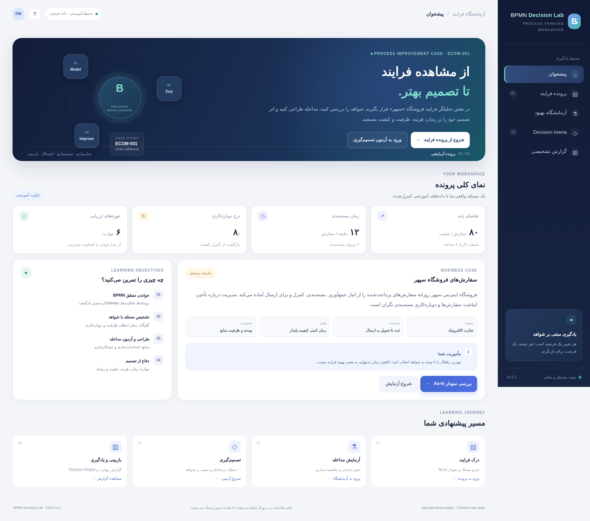
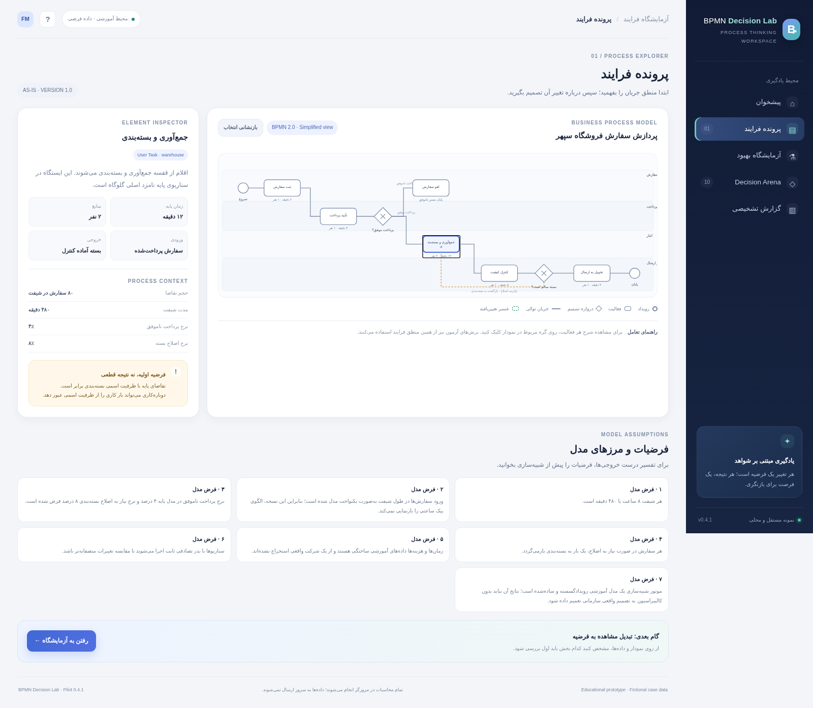
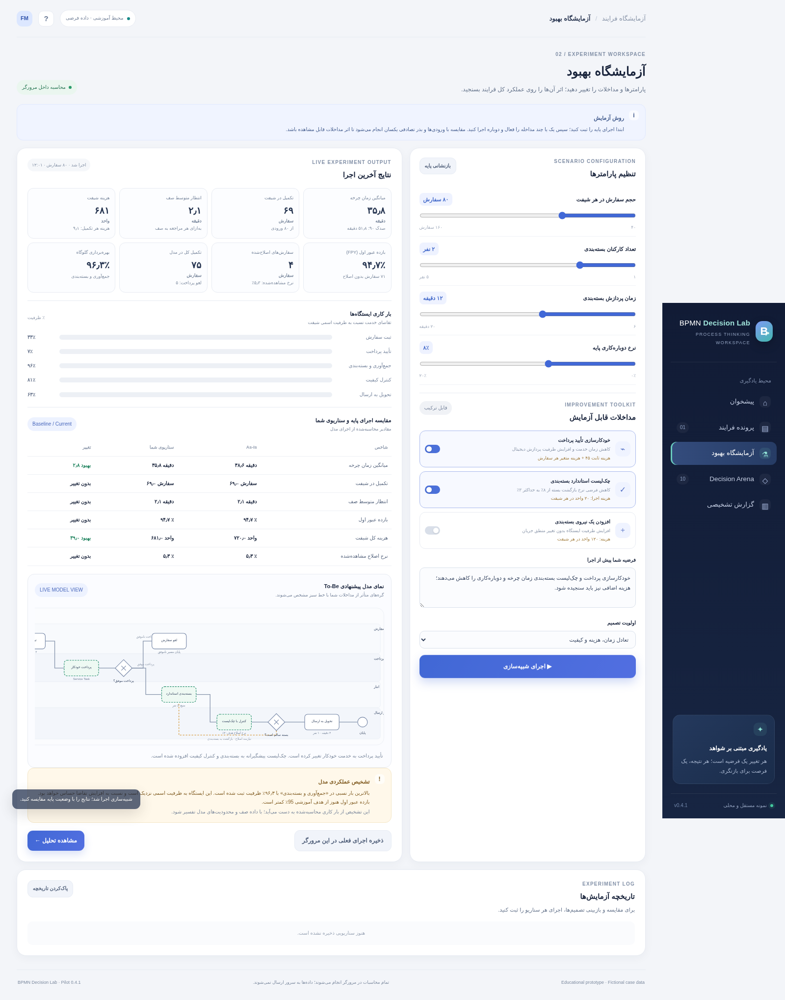
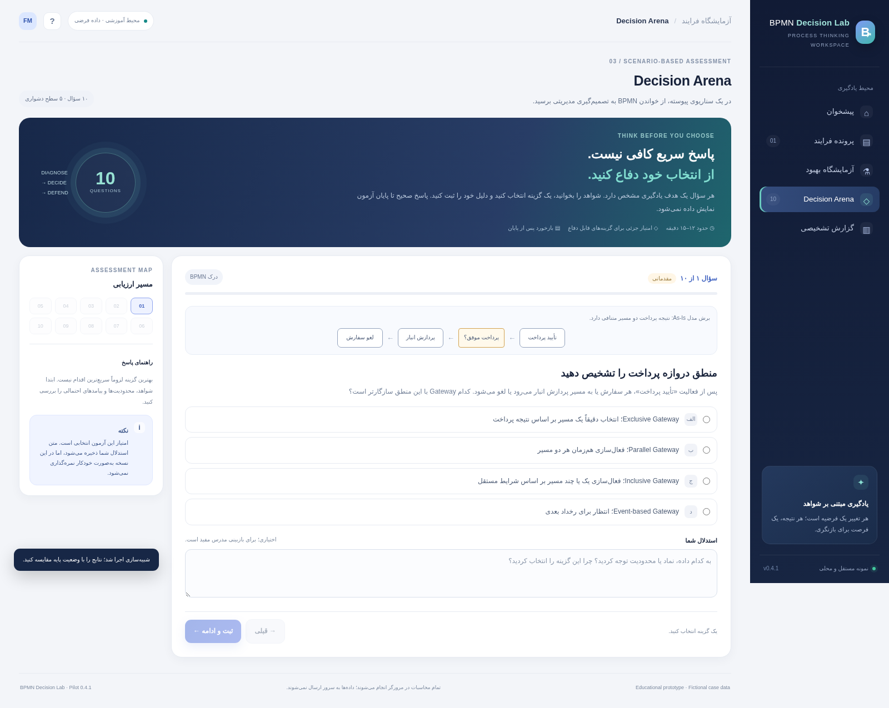

# آزمایشگاه تصمیم‌گیری فرایند BPMN

**یک محیط یادگیری کاملاً تحت وب برای مدل‌خوانی BPMN، تحلیل عملکرد، شبیه‌سازی و بهبود فرایندهای کسب‌وکار**

[English README](README.md) · [راهنمای انتشار در GitHub](docs/GITHUB_PUBLISHING_FA.md)

**نسخه پایلوت:** `0.4.1`  

این پروژه یک پایلوت آموزشی مستقل است که بر پایه یک پرونده فرضی فروشگاه اینترنتی طراحی شده است. دانشجو ابتدا فرایند As-Is را بررسی می‌کند، سپس پارامترها و مداخلات را تغییر می‌دهد، نتایج را با وضعیت پایه مقایسه می‌کند و در پایان در یک ارزیابی سناریومحور، منطق تصمیم‌هایش را محک می‌زند.

> **نکته مهم:** این پروژه خود نرم‌افزار Visual Paradigm نیست و از موتور شبیه‌سازی یا API آن استفاده نمی‌کند. این یک آزمایشگاه مستقل و مرورگرمحور است که تجربه آموزشی مدل‌سازی و بهبود فرایند را با امکانات اختصاصی خود پیاده می‌کند.

## اجرای سریع

1. فایل ZIP را از حالت فشرده خارج کنید یا مخزن را Clone کنید.
2. فایل `index.html` را با Chrome، Edge یا Firefox باز کنید.
3. از پیشخوان وارد «پرونده فرایند» شوید، روی فعالیت‌ها کلیک کنید، سپس در «آزمایشگاه بهبود» یک اجرای پایه بگیرید.
4. یک یا چند مداخله را انتخاب کنید، دوباره شبیه‌سازی را اجرا کنید و نمودارهای مقایسه را بخوانید.
5. وارد Decision Arena شوید و آزمون ۱۰ سؤالی را تکمیل کنید.
6. گزارش تشخیصی و Decision Replay را بررسی و در صورت نیاز خروجی JSON را دریافت کنید.

تمام منطق برنامه در مرورگر اجرا می‌شود. برای استفاده عادی نیازی به نصب کتابخانه، API، پایگاه‌داده یا سرویس بیرونی نیست. در صورت تمایل برای توسعه، می‌توانید از پوشه پروژه یک وب‌سرور محلی ساده اجرا کنید:

```bash
python -m http.server 8000
```

سپس نشانی `http://localhost:8000` را باز کنید. این وب‌سرور صرفاً روش ارائه فایل‌های استاتیک است و بک‌اند برنامه محسوب نمی‌شود.

## ساختار پروژه

```text
bpmn-decision-lab/
├── index.html
├── assets/
│   ├── favicon.svg
│   ├── styles.css
│   ├── data.js
│   ├── app.js
│   └── simulator.js
├── data/
│   ├── process-case.json
│   ├── improvement-actions.json
│   └── assessment.json
├── scripts/
│   ├── build-data.py
│   └── validate-project.py
├── tests/
│   └── smoke-test.js
├── docs/
│   ├── PRODUCT_REQUIREMENTS.md
│   ├── PRODUCT_BLUEPRINT.md
│   ├── ARCHITECTURE.md
│   ├── CASE_STUDY.md
│   ├── SIMULATION_MODEL.md
│   ├── ASSESSMENT_DESIGN.md
│   ├── QUESTION_AUTHORING_GUIDE.md
│   ├── DATA_DICTIONARY.md
│   ├── INSTRUCTOR_GUIDE.md
│   ├── PILOT_WALKTHROUGH_FA.md
│   ├── QA_TEST_REPORT.md
│   ├── ROADMAP.md
│   ├── GITHUB_PUBLISHING_FA.md
│   └── screenshots/
│       ├── overview.png
│       ├── process-explorer.png
│       ├── improvement-lab.png
│       ├── decision-arena.png
│       └── diagnostic-report.png
├── .github/
│   ├── ISSUE_TEMPLATE/
│   ├── workflows/quality-check.yml
│   └── PULL_REQUEST_TEMPLATE.md
├── .nojekyll
├── CITATION.cff
├── CHANGELOG.md
├── CONTRIBUTING.md
├── CODE_OF_CONDUCT.md
├── SECURITY.md
├── LICENSE
├── README.md
└── README.fa.md
```

## پیش‌نمایش محیط



| پرونده فرایند | آزمایشگاه بهبود | Decision Arena |
|---|---|---|
|  |  |  |

[مشاهده تصویر گزارش تشخیصی](docs/screenshots/diagnostic-report.png)

## اجزای اصلی آزمایشگاه

### ۱. Process Explorer

- نمایش نمودار ساده‌شده As-Is
- انتخاب هر فعالیت، رویداد یا Gateway
- مشاهده مسئولیت، زمان، منبع، ورودی و خروجی
- مشاهده فرضیات و مرزهای مدل

### ۲. Improvement Lab

- تغییر تقاضای هر شیفت
- تغییر تعداد بسته‌بندان
- تغییر زمان بسته‌بندی
- تغییر نرخ دوباره‌کاری
- خودکارسازی تأیید پرداخت
- افزودن چک‌لیست استاندارد بسته‌بندی
- افزودن یک نیروی بسته‌بندی
- مقایسه وضعیت پایه و سناریوی دانشجو
- ثبت تاریخچه سناریوها در مرورگر

### ۳. To-Be Preview

مداخلات انتخاب‌شده به‌صورت بصری روی گره‌های متأثر نمایش داده می‌شوند. این نما یک بازنمایی آموزشی از تغییر است؛ هنوز ویرایشگر آزاد BPMN یا اعتبارسنجی کامل استاندارد نیست.

### ۴. Decision Arena

ده سؤال در پنج سطح از مقدماتی تا پیشرفته:

1. درک منطق BPMN
2. تشخیص مسئله با شواهد
3. محاسبه ظرفیت و تحلیل کمی
4. تحلیل دوباره‌کاری و انتخاب مداخله
5. بازطراحی، موازی‌سازی، مدیریت ظرفیت و قضاوت مدیریتی

سؤال‌ها می‌توانند شامل برش نمودار، داده‌های عددی، فرمول ظرفیت، یا سناریوی عملیاتی باشند. در هشت سؤال تحلیلی، ثبت استدلال کوتاه (حداقل ۱۵ نویسه) برای ادامه الزامی است؛ در دو سؤال مفهومی، نوشتن استدلال اختیاری است. پاسخ‌ها و پیامد گزینه‌های دیگر پس از اتمام آزمون آشکار می‌شوند.

### ۵. گزارش تشخیصی

- نمره وزن‌دار کل
- امتیاز بر اساس شایستگی
- آسیب‌شناسی انتخاب‌های دارای امتیاز ناقص یا ضعیف و دسته‌بندی ریسک‌های تصمیم
- میزان پوشش استدلال مکتوب (نه نمره کیفیت استدلال)
- تعداد شواهد هر حوزه
- پیشنهاد تمرین بعدی
- بازبینی تک‌تک سؤال‌ها
- مقایسه انتخاب دانشجو با گزینه دارای بالاترین امتیاز در سناریوی فعلی
- نمایش پیامد محتمل سایر گزینه‌ها
- بررسی آخرین اجرای شبیه‌سازی
- خروجی JSON و چاپ گزارش

نمره آزمون، عملکرد دانشجو در همین سناریو را توصیف می‌کند و نباید به‌عنوان تشخیص قطعی توانمندی حرفه‌ای یا نمره‌گذاری خودکار استدلال آزاد استفاده شود.

## پرونده آموزشی: فروشگاه اینترنتی سپهر

فرایند از ثبت سفارش شروع می‌شود، پرداخت بررسی می‌شود، سفارش پرداخت‌شده وارد انبار می‌شود، بسته‌بندی و کنترل کیفیت انجام می‌گیرد و در نهایت بسته به واحد ارسال تحویل داده می‌شود. پرداخت ناموفق به مسیر لغو می‌رود و بسته معیوب یک بار به بسته‌بندی بازمی‌گردد.

تمام زمان‌ها، هزینه‌ها و نرخ‌ها فرضی و برای تمرین ساخته شده‌اند. این داده‌ها به هیچ شرکت واقعی تعلق ندارند.

## توسعه محتوا

فایل‌های `data/*.json` منبع اصلی اطلاعات هستند. برای بازسازی داده‌ای که مرورگر می‌خواند:

```bash
python scripts/build-data.py
```

سپس تست پایه را اجرا کنید:

```bash
python scripts/validate-project.py
node tests/smoke-test.js
node --check assets/app.js
node --check assets/simulator.js
```

فایل `assets/data.js` تولید خودکار دارد و نباید مستقیماً ویرایش شود.

## انتشار در GitHub

راهنمای کامل ساخت مخزن، بارگذاری فایل‌ها با رابط وب یا Git، فعال‌سازی GitHub Pages، کنترل کیفیت خودکار و نکات عمومی/خصوصی بودن مخزن در [`docs/GITHUB_PUBLISHING_FA.md`](docs/GITHUB_PUBLISHING_FA.md) قرار دارد. راهنمای اجرای سناریوی نمونه در [`docs/PILOT_WALKTHROUGH_FA.md`](docs/PILOT_WALKTHROUGH_FA.md) و گزارش کنترل کیفیت در [`docs/QA_TEST_REPORT.md`](docs/QA_TEST_REPORT.md) قرار دارد. 

## محدودیت‌های فعلی

- مدل فقط یک فرایند آموزشی مشخص را پوشش می‌دهد.
- نمودار BPMN قابل کلیک است، اما ویرایشگر آزاد گرافیکی ندارد.
- موتور شبیه‌سازی ساده‌شده است و با داده واقعی سازمان کالیبره نشده است.
- ورود سفارش یکنواخت فرض شده و الگوی پیک، شیفت‌های متفاوت و تقویم کاری مدل نشده‌اند.
- تحلیل پیامدها مبتنی بر قواعد تعریف‌شده در بانک سؤال است؛ داوری خودکار متن استدلال انجام نمی‌شود.
- ذخیره فعلی در Local Storage همان مرورگر است؛ همگام‌سازی بین دستگاه‌ها وجود ندارد.
- همکاری گروهی، پنل مدرس و مدیریت چند پرونده هنوز در نقشه راه قرار دارند.

## مجوز

کد، مستندات و داده‌های آموزشی این مخزن تحت مجوز MIT منتشر شده‌اند؛ جزئیات در فایل `LICENSE` آمده است.
