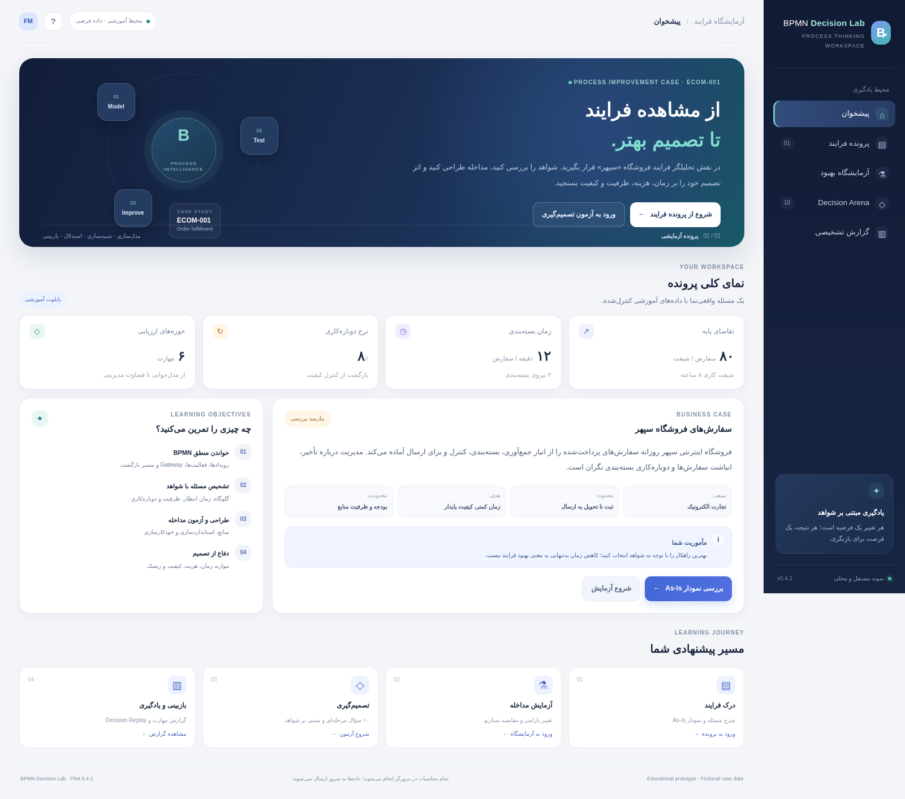
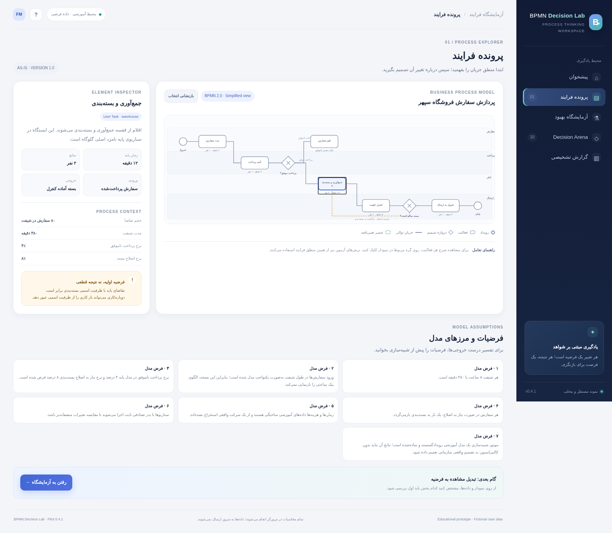
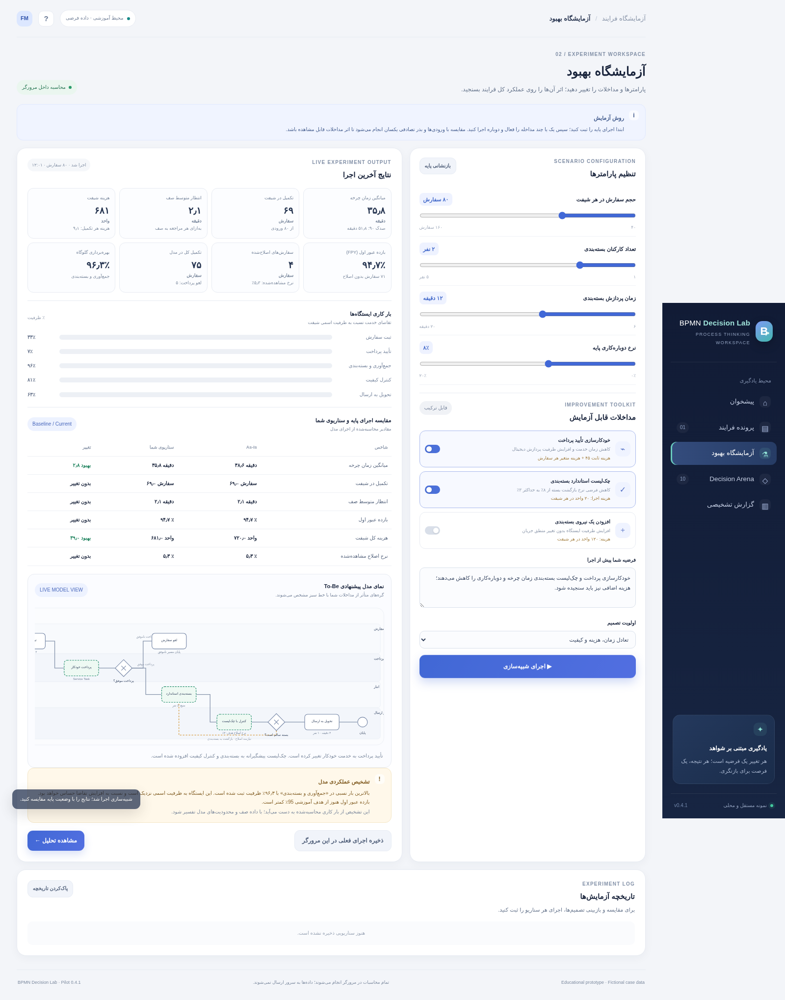
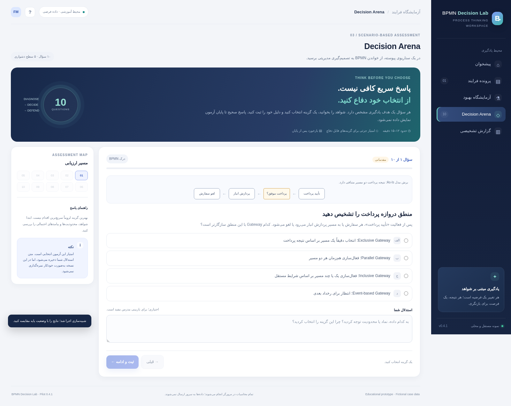

# BPMN Decision Lab

**A browser-only learning environment for BPMN process analysis, simulation, assessment, and improvement.**

[Persian documentation](README.fa.md)

BPMN Decision Lab is an educational prototype built around a fictional e-commerce order-fulfilment case. It combines a clickable process model, a deterministic discrete-event teaching simulator, configurable improvement interventions, a scenario-based assessment, and a diagnostic decision-review report.

- **Language:** Persian (RTL interface)
- **Runtime:** Static HTML, CSS, and vanilla JavaScript
- **External services:** None
- **Build requirement:** None for normal use
- **Data:** Fictional, illustrative teaching data

## Run the pilot

1. Download or clone the repository.
2. Open `index.html` in a modern browser (Chrome, Edge, or Firefox).
3. Explore the case, run a baseline simulation, try interventions, complete Decision Arena, and review the report.

The app is designed to work offline. It does not call an external API or transmit learner data. Scenario history and assessment answers are stored locally in the browser where supported.

> For a local development server, run `python -m http.server 8000` from the repository root and open `http://localhost:8000`. This is optional; it is not an application backend.

## Repository map

```text
bpmn-decision-lab/
├── index.html                    # Application shell and all page views
├── assets/
│   ├── favicon.svg
│   ├── styles.css                # Responsive RTL visual system
│   ├── data.js                   # Generated browser data bundle
│   ├── app.js                    # Navigation, BPMN view, assessment, reporting
│   └── simulator.js              # Deterministic process simulation engine
├── data/
│   ├── process-case.json         # Case study, model metadata, assumptions
│   ├── improvement-actions.json  # Intervention definitions and risks
│   └── assessment.json           # Question bank, scoring, feedback, impacts
├── scripts/
│   ├── build-data.py             # Generates assets/data.js from canonical JSON
│   └── validate-project.py       # Checks required files and local references
├── tests/
│   └── smoke-test.js             # Data and simulation sanity checks
├── docs/                         # Product, learning, case, model, pilot and publishing guides
├── .github/
│   ├── ISSUE_TEMPLATE/           # Bug and feature request forms
│   ├── workflows/                # Automated quality checks
│   └── PULL_REQUEST_TEMPLATE.md
├── .nojekyll                     # GitHub Pages helper
├── CITATION.cff                  # Repository citation metadata
├── CONTRIBUTING.md
├── LICENSE
└── README.fa.md                  # Full Persian project guide
```

## Interface preview



| Process explorer | Improvement lab | Decision Arena |
|---|---|---|
|  |  |  |

[View diagnostic report screenshot](docs/screenshots/diagnostic-report.png).

## What is in the pilot?

| Module | Purpose |
|---|---|
| Overview | Introduces the case and learning objectives |
| Process Explorer | Clickable simplified BPMN process view and element inspector |
| Improvement Lab | Demand, staffing, processing-time and rework controls; three interventions; simulation and KPI comparison |
| To-Be Preview | Highlights process elements affected by selected interventions |
| Decision Arena | Ten staged questions across five difficulty levels; eight require a short written rationale |
| Diagnostic Report | Weighted score, competency profile, learning recommendations, and Decision Replay |
| Experiment History | Saves selected runs in the current browser |
| JSON Export | Exports the assessment and latest simulation record |

## Important scope statement

This is **not Visual Paradigm software** and it does not embed or reproduce the Visual Paradigm simulation engine. It is an independent, browser-native educational prototype inspired by process-modelling and process-improvement workflows. The BPMN visual is a simplified teaching view of the case, not a complete BPMN 2.0 editor or conformance validator.

## Simulation model in brief

The simulator uses a simple deterministic-seed, single-shift, discrete-event queue model. Orders arrive uniformly over a 480-minute shift and pass through registration, payment, packing, quality control, and dispatch. Payment failures cancel an order. A quality failure sends an order through one rework loop. Each work centre has a finite number of parallel servers and uses an earliest-available-server queue rule.

The same random seed is used for the baseline and intervention run to make scenario comparisons more stable. This does not make the model empirically validated. Read [`docs/SIMULATION_MODEL.md`](docs/SIMULATION_MODEL.md) before interpreting results.

## Edit the content

The canonical content is stored in `data/*.json`.

After editing the JSON files, rebuild the browser bundle:

```bash
python scripts/build-data.py
```

Then validate the project and run the smoke checks:

```bash
python scripts/validate-project.py
node tests/smoke-test.js
node --check assets/app.js
node --check assets/simulator.js
```

Do not edit `assets/data.js` by hand; it is generated from the JSON files.

## Publish with GitHub Pages

This is a static website and can be published directly from the repository root. Create a repository, upload the contents of this folder, then open **Settings → Pages → Build and deployment**. Choose **Deploy from a branch**, select `main` and `/(root)`, and save. See the official [GitHub Pages publishing guide](https://docs.github.com/en/pages/getting-started-with-github-pages/configuring-a-publishing-source-for-your-github-pages-site).

GitHub Pages sites are public on the internet. Review the contents and choose repository visibility deliberately before enabling Pages.

## Roadmap

See [`docs/ROADMAP.md`](docs/ROADMAP.md) for the staged plan and [`docs/QA_TEST_REPORT.md`](docs/QA_TEST_REPORT.md) for the checks performed on this build. The Persian [pilot walkthrough](docs/PILOT_WALKTHROUGH_FA.md) describes a recommended learner journey. The next meaningful upgrades are: richer BPMN element coverage, editable flow rules, calibration data import, sensitivity and scenario batch analysis, stronger accessibility, instructor authoring tools, and more assessment item types.

## License

The source code and project documentation are released under the MIT License; see [`LICENSE`](LICENSE). The fictional case data and question bank are included in this repository under the same license unless otherwise noted.
